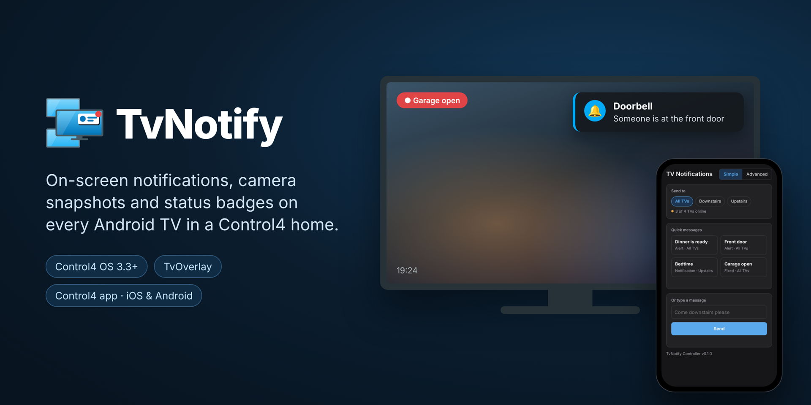
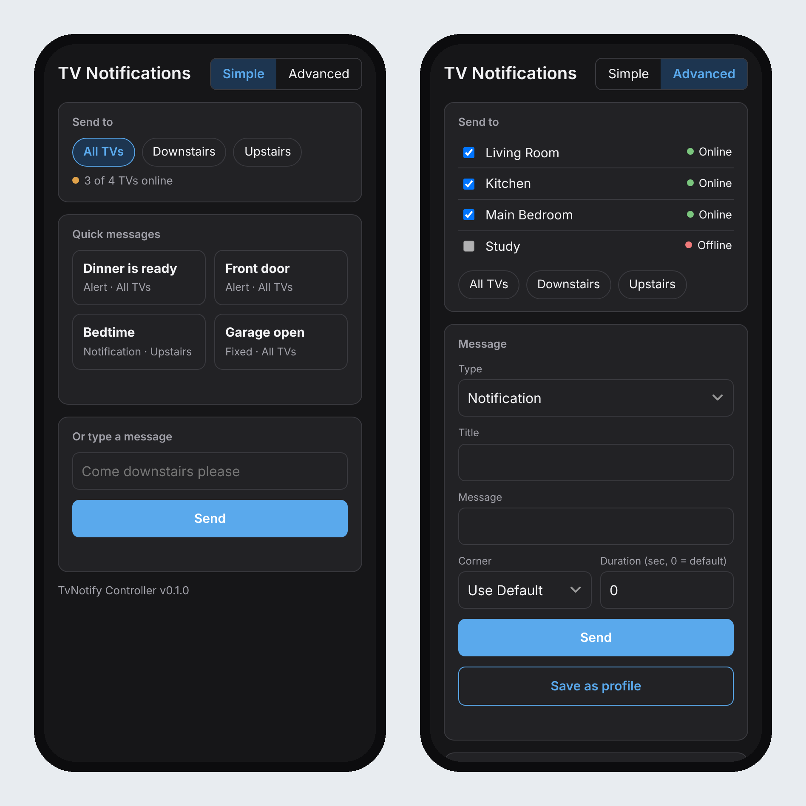
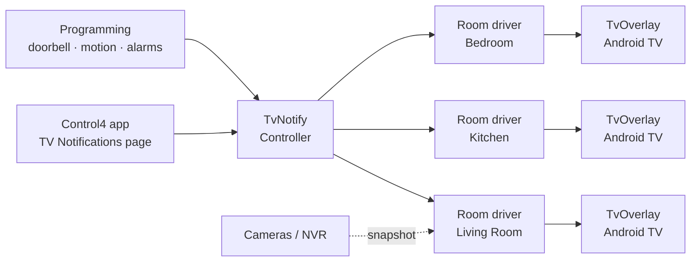

  

  
  
  
  

  <b>Pop-up notifications, camera snapshots and status badges on every Android TV in a Control4 home.</b> 
  <a href="#-download">Download</a> ·
  <a href="#-quick-start">Quick start</a> ·
  <a href="#-screenshots">Screenshots</a> ·
  <a href="#-how-it-works">How it works</a> ·
  <a href="#-faq">FAQ</a> ·
  <a href="#-licence">Licence</a>

---

## ✨ What it does

TvNotify is a pair of Control4 DriverWorks drivers for the [TvOverlay](https://github.com/gugutab/TvOverlay) app on Android TV and Google TV devices.

| | |
|---|---|
| 🔔 **Notifications & alerts** | Title, message, icon and colour, in any corner. 14 ready-made alert styles: doorbell, motion, water leak, package and more. |
| 📷 **Camera snapshots** | Show a still or live stream from any Control4 camera, including cameras on an NVR. The camera's own address and login are read automatically. Built-in formats for Hikvision, Dahua / Amcrest, Foscam, Reolink and Axis, plus your own. |
| 📌 **Status badges** | Small fixed badges such as *Garage open* that stay on screen until cleared, or expire on a timer. |
| 📱 **TV Notifications page** | Send from the Control4 app on iOS and Android: one tap for saved messages, or type your own. Works in light and dark mode. |
| 🏠 **Whole-home targeting** | One Controller for up to 12 TVs, with up to 6 subgroups such as *Upstairs* or *Kids' rooms*, and online status for each TV. |
| ⚙️ **Programming** | Send from any event: doorbell pressed, motion detected, alarm armed. Up to 20 saved profiles, each sent with one command. |

## 📸 Screenshots

  

  <b>Simple</b>: one-tap quick messages and a free-text box &nbsp;·&nbsp;
  <b>Advanced</b>: pick TVs, message type, corner and duration, then save it as a profile

## 🧩 How it works

| Driver | File | Role |
|---|---|---|
| **TvNotify for Android TV** (room driver) | `tvnotify_android_tv.c4z` | One per TV. Talks to TvOverlay on the TV endpoint over its REST API (port 5001). Can be used on its own. |
| **TvNotify Controller** | `tvnotify_controller.c4z` | Sends to several room drivers at once, holds the profiles, and provides the *TV Notifications* button in the Control4 app. |

## 📦 Download

Get the latest `.c4z` files from **[Releases](../../releases/latest)**.

> [!IMPORTANT]
> Rename the files to `tvnotify_android_tv.c4z` and `tvnotify_controller.c4z` before adding them in Composer. Composer identifies a driver by its file name, so updates are only recognised under the same name.

## ✅ Requirements

- Control4 OS **3.3.0 or later** and Composer Pro.
- [TvOverlay](https://github.com/gugutab/TvOverlay) installed on each Android TV, with its setup complete (permissions granted; the app opens without prompts).
- Each TV already in the project with its own driver (for example the manufacturer's driver) that holds its IP address. A DHCP reservation for each TV is recommended.

## 🚀 Quick start

**1. Room driver (one per TV)**

1. In Composer, add **TvNotify** to the room the TV is in.
2. Under *TV Connection*, choose the TV's driver in **TV Driver**. The room driver reads the TV's IP address from it. Leave **TV Port** at 5001.
3. Press **Send Test Notification** (Actions tab). A pop-up appears on the TV and *Status* shows **Online**.
4. *Optional:* for camera pop-ups, leave *Camera Snapshots* at **Auto Detect** / **Use Device's Own Settings**. Each camera's address and login come from the project.

**2. Controller (optional, for several TVs)**

1. Add **TvNotify Controller** to the project, in any room.
2. In *Connections*, connect each **TV Member** binding to a room driver, then set **Number of TV Members**.
3. *Optional:* set up subgroups and profiles in its properties.
4. Show the button in each room: *Room Properties → Navigator → Device Visibility*, tick **TvNotify Controller**, then refresh the Navigators.

Full instructions, properties and commands are in each driver's **Documentation** tab in Composer.

## 🛠️ Programming

| Room driver commands | Controller commands |
|---|---|
| Send Notification · Send Alert · Send Camera Notification · Send Fixed Notification · Remove Fixed Notification · Remove All Fixed Notifications · Set Overlay · Set Notification Settings · Set Settings · Set MQTT · Send Raw JSON | Send Profile · Clear Profile Badge · Send Notification · Send Alert · Send Camera Notification · Send Fixed Notification · Remove Fixed Notification · Remove All Fixed Notifications · Set Overlay · Set Notification Settings |
| **Events:** Notification Sent · Request Failed · TV Online · TV Offline | **Events:** Member Online · Member Offline · All Members Online · Not All Members Online |

**Example:** *When the doorbell is pressed* → **TvNotify Controller → Send Profile → "Front door"**, or **Send Camera Notification** with the porch camera to show who's there.

## ❓ FAQ

<b>Badges don't appear on the TV, but pop-ups do</b>

In TvOverlay, fixed notifications follow the clock's visibility by default. If the clock is set to 0% (hidden), badges are hidden too. Set **Fixed Notification Visibility** with the *Set Notification Settings* command, or raise **Clock Visibility** with *Set Overlay*.

<b>The room driver says it can't read the TV's IP address</b>

Some TV drivers don't share their address. Enter it in **Manual IP Address (fallback)**. **Dump TV Driver Info** (Actions tab) writes a report to the Lua output explaining why.

<b>A camera snapshot fails with a login error</b>

Run **Dump Camera Info** (Actions tab) for that camera. Its *CAMERA SETTINGS* and *LOGIN* lines show which address and login were used. Passwords are hidden.

<b>The TV Notifications button doesn't appear in the app</b>

Tick **TvNotify Controller** in the room's *Navigator → Device Visibility*, then refresh the Navigators. The page only works inside the Control4 app, not in a desktop browser.

<b>Can it turn the TV on?</b>

No. TvOverlay runs on the TV, so the TV must be on (or in a state where apps keep running) to show notifications. Use the TV's own Control4 driver to switch it on first.

## 🙏 Credits

- [TvOverlay](https://github.com/gugutab/TvOverlay) by gugutab: the Android TV app that displays the notifications.
- Drivers by **popolou** ([ThePopolou/TvNotify](https://github.com/ThePopolou/TvNotify)).

> TvNotify is an independent project. It is not affiliated with or endorsed by Control4, Snap One or the TvOverlay author.

## 📄 Licence

Copyright © 2026 popolou. TvNotify is free software, released under the **[GNU General Public License v3.0](LICENSE)**.

You may use, change and share it, including on paid installations. If you share a changed version, it must also be released under GPL-3.0 with its source. It comes with no warranty.
